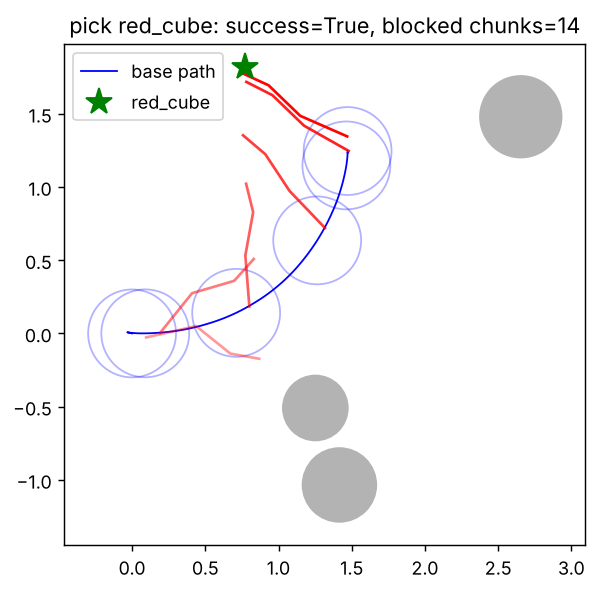
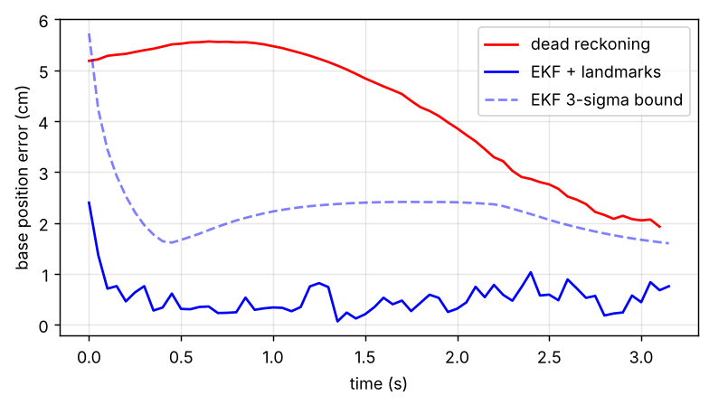
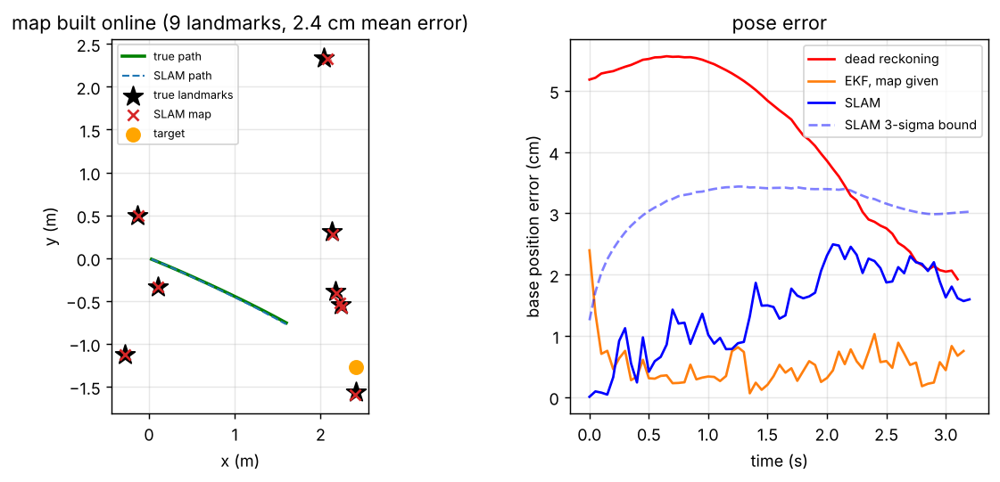
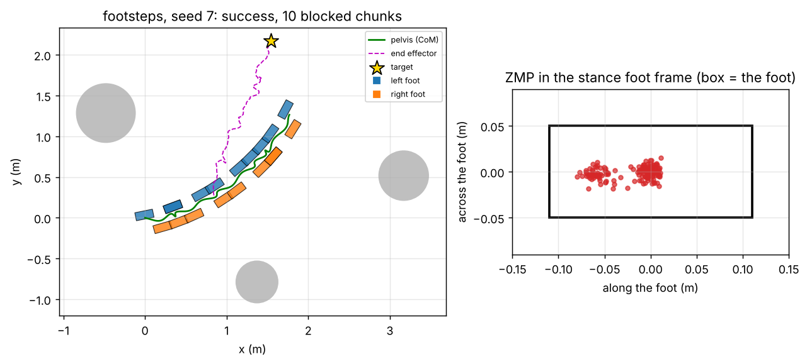

# safegait

A small study of **safe whole-body control for a mobile manipulator**: a policy proposes
*chunks* of commands, and a validator predicts their effect and only lets the safe part
through to the robot. The robot comes in two kinds: the original **wheeled** base, and a **walking** base
modelled as a linear inverted pendulum with footstep planning (section "Walking").



*A noisy policy asked to "pick up the red cube". Grey discs are obstacles, blue is the base path,
red is the arm. The validator blocked 14 chunks on the way; none were executed.*

## What is in here

| Module | What it does |
|---|---|
| `kinematics.py` | Differential-drive base + 3-link arm: forward kinematics, analytic Jacobian that includes the non-holonomic constraint, integrator. |
| `controller.py` | Whole-body reaching: weighted damped least squares for the 2-D task over 5 commands, with a null-space posture term. |
| `policy.py` | Chunk-producing policies. `JacobianPolicy` rolls the controller forward; `NoisyPolicy` adds noise and glitches to imitate an imperfect learned model. |
| `validator.py`, `safety.py` | Rolls a chunk forward and returns the longest prefix that respects velocity limits, joint limits and obstacle clearance (with a margin). |
| `commands.py` | Plain-English command -> task on a known object. |
| `runner.py`, `evaluate.py` | Closed-loop episodes and the with/without-validator comparison (perfect pose). |
| `localisation.py` | EKF for the base pose: odometry prediction, range-bearing landmark updates, NEES consistency check. |
| `localised_runner.py`, `evaluate_loc.py` | Episodes where the policy and validator only see the *estimated* pose; real slip the filter does not know about. |
| `slam.py` | EKF-SLAM: pose and landmark map in one state, landmarks created on first sight, data association by Mahalanobis gating. No map and no landmark identities are given. |
| `evaluate_slam.py` | SLAM experiments: estimator quality, validator on the SLAM estimate, landmark-density sweep. |
| `gait.py` | Biped walking model (linear inverted pendulum): velocity command -> footsteps -> divergent-component-of-motion (DCM) plan -> ZMP tracking inside the stance foot. |
| `gait_validator.py` | Validator for the walking robot: rolls out the gait, checks collisions, limits, reach, and that the ZMP needed fits in the foot; accepts only prefixes the robot can brake after. |
| `planner.py`, `evaluate_planner.py` | Occupancy grid + A*, wrapped as a two-phase policy: navigate along a planned path with the arm folded, then hand over to the manipulation policy. |
| `learned.py`, `evaluate_learned.py` | A small MLP (numpy) imitating the planner-plus-controller from a local view, trained by behaviour cloning + DAgger; the validator on that policy. Trained models are in `models/`. |
| `physics_g1.py` | Optional MuJoCo check of the walker's assumptions on a real humanoid model (Unitree G1): shove tolerance and how much the arms move the CoM. It does not make the G1 walk. |
| `gait_runner.py`, `evaluate_gait.py` | Walking episodes with ZMP noise and shoves the validator cannot see; gait, ablation, shove and "why blocked" experiments. |

## Run it

```bash
python3 -m venv .venv && source .venv/bin/activate
pip install -e ".[dev]"
pytest                                   # 79 tests, ~40 s (5 of them need MuJoCo and the G1 model, see below; they skip otherwise)
python -m safegait.evaluate --episodes 50            # perfect pose
python -m safegait.evaluate_loc --episodes 50        # EKF localisation
python -m safegait.evaluate_loc --episodes 400 --stress --seed 1000
python -m safegait.evaluate_slam --episodes 50       # SLAM: experiments A, B, C
python -m safegait.evaluate_slam --episodes 400 --stress --seed 1000 --only b
python scripts/demo.py 8 demo.png
python scripts/localisation_plot.py 2 localisation.png
python scripts/slam_plot.py 2 slam.png
python -m safegait.evaluate_gait --episodes 300      # walking: experiments A, B, C, D
python scripts/gait_plot.py 7 gait.png
python -m safegait.evaluate_planner --episodes 100   # planner: wheeled, walker, what stalls are left
python -m safegait.evaluate_learned --episodes 200   # learned policy, raw vs validated (add --obstacles 6 for the shift)
python -m safegait.learned --robot wheeled           # retrain (about 3 minutes); --robot walker for the walker model

pip install mujoco                                    # optional: the physics check
python -m safegait.physics_g1 --fetch third_party/g1 # downloads the G1 model (BSD-3, MuJoCo Menagerie)
python -m safegait.physics_g1                        # shove tolerance and arm CoM shift; add --ablate
```

No GPU, no ROS, no simulator install: NumPy only (matplotlib for the demo plot).

## Result (50 episodes, 3 random obstacles, seed 0)

| policy | validator | success | collision | limit violation | stalled |
|---|---|---|---|---|---|
| clean | off | 84% | 16% | 0% | 0% |
| clean | on  | 80% | 0% | 0% | 20% |
| noisy | off | 78% | 22% | 82% | 0% |
| noisy | on  | 78% | 0% | 0% | 22% |

With the validator on, no episode collided or exceeded a limit. The cost is that some episodes end
in a stall (the policy keeps proposing something unsafe) instead of a crash.

## Localisation (EKF) results

The base pose is estimated from odometry plus range-bearing measurements of 8 known landmarks. The
real robot slips (per-episode wheel-scale error and yaw-rate bias, plus per-step noise) in a way the
filter is not told about, so landmarks have to correct real drift. Arm joints come from encoders and are treated as known.



**A. Estimator quality** (50 episodes, no obstacles)

| estimator | mean position error | final position error | mean NEES (ideal 3) | steps inside 95% NEES bound |
|---|---|---|---|---|
| dead reckoning | 8.6 cm | 12.1 cm | 8.65 | 71% |
| EKF + landmarks | 0.8 cm | 0.6 cm | 4.70 | 86% |

The EKF is clearly better, but with mean NEES 4.7 it is somewhat **over-confident** (its reported
uncertainty is smaller than its real error). Landmark measurements are also assumed independent from step to step,
which flatters the filter. Retuning the process noise is an open item.

**B. Validator on the estimated pose** (noisy policy, 3 obstacles)

With good sensing, localisation error (about 1 cm) is far below the validator's 5 cm margin, so validating on the
estimate is as safe as validating on the true pose: all three validator modes were indistinguishable. That test
could not tell them apart, so I added a stress condition: 3 landmarks, 1.5 m sensor range, doubled sensor noise
and larger slip (400 episodes, seed 1000):

| validator mode | success | collision | limit violation | stalled |
|---|---|---|---|---|
| raw (no validator) | 28% | 28% | 76% | 0% |
| oracle (true pose) | 26% | 0% | 0% | 33% |
| est (estimated pose, 5 cm margin) | 26% | 5% | 0% | 28% |
| est_inflated (margin grows with filter uncertainty) | 23% | 2% | 0% | 38% |

Under degraded sensing, validating on the estimate lets some collisions through (5%), and growing the margin with the
filter's own uncertainty cuts that to 2% at the price of more stalls and lower success. It does not reach the
oracle's 0%, probably because the filter is over-confident here (it does not model the slip bias), though I have not tested that explanation.
Success is low in this condition mainly because the robot declares arrival from a drifted estimate.
Success here means the *true* end effector is within 10 cm when the *estimated* one is within 5 cm.

## SLAM (map and landmark identities unknown)

The EKF above is *localisation*: it is handed the map and knows which landmark it is looking at.
`slam.py` removes both. The filter gets only odometry and unlabelled (range, bearing) detections, keeps the
landmark map in its state vector (with robot-landmark cross-covariances), creates a landmark when it first sees
one, and decides for every detection whether it is an existing landmark, a new one, or too ambiguous to use
(Mahalanobis gates at 99% and 99.99%, one detection per landmark per scan).



*One episode (seed 2, 8 landmarks). The map is built while driving. The filter ended with 9 landmarks for 8 real ones:
one duplicate. SLAM starts from the exact start pose (it defines the map frame); the other estimators start with 5 cm of
initial error, which is why their curves start higher.*

**A. Estimator quality** (50 episodes, 8 landmarks, no obstacles). "Association given" supplies the true landmark id and
isolates SLAM error from data-association error.

| estimator | mean pos err (cm) | final pos err (cm) | mean NEES (ideal 3) | inside 95% bound | map err (cm) | map size / landmarks seen | duplicates/ep | wrong associations | ambiguous/ep |
|---|---|---|---|---|---|---|---|---|---|
| dead reckoning | 8.64 | 12.12 | 8.65 | 71% | – | – | – | – | – |
| EKF, map given | 0.84 | 0.55 | 4.70 | 86% | – | – | – | – | – |
| SLAM, association given | 1.42 | 1.92 | 7.31 | 72% | 2.5 | 7.7 / 7.7 | 0.00 | 0.0% | 0.0 |
| SLAM, association estimated | 1.49 | 1.99 | 7.81 | 69% | 2.9 | 8.0 / 7.7 | 0.26 | 1.2% | 5.6 |

- SLAM, with no map and no labels, gets within about 1.5 cm of the true position, against 8.6 cm for dead reckoning, and builds a map
  with 2.9 cm mean error. It is worse than the known-map EKF (1.5 vs 0.8 cm): the map is built from a drifting pose, so it cannot
  provide an absolute correction the way a given map does.
- Estimating the association costs little here (1.49 vs 1.42 cm). 1.2% of matches were to the wrong landmark and 0.26 duplicate landmarks
  appeared per episode.
- **Over-confidence comes from the unmodelled slip.** SLAM's NEES (7.8) is further from 3 than the EKF's (4.7). With the per-episode
  slip bias removed (`--no-slip`), dead reckoning is consistent (NEES 2.70, 97% inside the bound), the EKF gives 2.35, SLAM 1.3 to 1.4
  (slightly conservative), and **SLAM matches the known-map EKF's accuracy (0.71 vs 0.72 cm)**. That also checks the SLAM implementation itself: given a
  correct motion model it loses nothing against a filter that was handed the map.

**C. Landmark density** (50 episodes). Denser landmarks help accuracy but make association harder:

| landmarks in world | seen per episode | mean pos err (cm) | wrong associations | duplicates/ep | ambiguous/ep |
|---|---|---|---|---|---|
| 4 | 3.9 | 2.03 | 0.79% | 0.06 | 3.0 |
| 8 | 7.7 | 1.49 | 1.21% | 0.26 | 5.6 |
| 16 | 15.4 | 1.15 | 1.60% | 0.66 | 9.2 |
| 32 | 30.9 | 0.84 | 4.46% | 2.42 | 19.6 |
| 64 | 61.7 | 0.69 | 8.67% | 7.92 | 46.6 |

Position error keeps falling up to 64 landmarks even as wrong matches and duplicates grow, so in this setup extra information outweighs the confusion.
Detections are not shuffled, but they arrive in landmark-index order and the landmarks are placed at random, so the order carries no geometry.

**B. Validator on the SLAM estimate** (noisy policy, 3 obstacles). Normal conditions (50 episodes, 8 landmarks): every
validator mode (oracle, est, est_inflated) gave 0% collisions and 0% limit violations on the SLAM estimate, as on the EKF estimate. Success was lower
(68% vs 74% for the validated modes). The difference is three episodes where the true end effector finished 10.4 to 11.3 cm from the target against the 10 cm
success threshold, with SLAM base-position errors of 1.7 to 4.6 cm at the end (oracle mode; the other validated modes show the same 68%). With only 50 episodes this is suggestive, not conclusive.

Stress condition (3 landmarks, 1.5 m range, noisier sensor, larger slip; 400 episodes, seed 1000):

| estimator | validator mode | success | collision | limit violation | stalled | blocked chunks/ep |
|---|---|---|---|---|---|---|
| EKF (map given) | raw | 28% | 28% | 76% | 0% | 0.0 |
| EKF (map given) | oracle | 26% | 0% | 0% | 33% | 6.2 |
| EKF (map given) | est | 26% | 5% | 0% | 28% | 5.9 |
| EKF (map given) | est_inflated | 23% | 2% | 0% | 38% | 6.2 |
| SLAM | raw | 12% | 28% | 76% | 0% | 0.0 |
| SLAM | oracle | 13% | 1% | 0% | 32% | 6.2 |
| SLAM | est | 13% | 6% | 0% | 29% | 6.0 |
| SLAM | est_inflated | 12% | 4% | 0% | 35% | 6.2 |

- **Success roughly halves under SLAM** (12 to 13% vs 23 to 28%). The robot sees only 1.6 of the 3 landmarks on average, so SLAM never gets an absolute
  anchor: its final position error is about 22 cm, close to dead reckoning (27.8 cm) and far from the known-map EKF (9.9 cm)
  (`evaluate_slam --stress --only a`). It then declares arrival from a drifted estimate.
- **Collision rates are not distinguishable between SLAM and the EKF.** SLAM lets 6% and 4% through (est, est_inflated) against 5% and 2%
  for the EKF. At 400 episodes the standard error on a rate near 5% is about 1 point, so a 1 to 2 point gap is within noise. Do not read this as "SLAM is
  as safe": the experiment cannot tell.
- **Every filter is badly over-confident here** (NEES 40 to 250 in this condition, including the known-map EKF at 81). A margin that grows with the filter's own
  uncertainty (`est_inflated`) can only be as trustworthy as that uncertainty.
- The oracle mode, which validates on the true pose, still let 1% of SLAM episodes collide. The validator predicts the *commanded* motion while the real robot slips, which is the likely cause; I did not test it.

## Walking (a biped model, not a wheeled base)

`gait.py` replaces the unicycle with something that walks. The pelvis is the centre of mass of an inverted pendulum
(`c'' = w^2 (c - z)`, height 0.65 m), it only touches the ground at footsteps, and it can only be pushed around by moving
the zero-moment point (ZMP) `z` inside the stance foot. A velocity command becomes footsteps, the divergent component of motion
(DCM, `c + c'/w`) is planned backwards from the last footstep, and a DCM tracker keeps the ZMP inside a 22 x 10 cm foot
(Kajita 2001, Englsberger 2015). The same whole-body controller drives it: its (v, w) become step commands, its arm rates
are applied per tick.



*One episode (seed 7, noisy policy, validator on). Left: footsteps (blue left, orange right), pelvis path, end effector.
Right: where the ZMP sat inside the foot; cruising at the centre, braking about 6 cm back.*

`gait_validator.py` rolls the gait forward instead of a unicycle, so it sees the 13 cm lateral sway and the lag between command and
motion. On top of the wheeled checks (collision, joint limit, velocity) it adds: **balance** (the ZMP needed to land the next step on its
plan must fit inside the foot, minus a reserve), **reach** (the legs can place the step), and **safe stop** (the plan is the accepted steps
followed by two braking steps, and all of it must be safe). The robot executes the first step, keeps the rest of the validated plan as a
backup, and replans. Base velocity is judged on the step-averaged command, because a footstep is a whole-step decision; arm rates stay per tick.

**A. The gait.** The controller tracks its command exactly (0.250 and 0.500 m/s achieved). Walking steadily uses none of the foot (the ZMP
sits at its centre); braking in one step from 0.5 m/s needs 61% of the foot half-length.

| commanded speed (m/s) | achieved (m/s) | ZMP shift needed to brake in one step | push tolerance forward (cm) | backward | left | right |
|---|---|---|---|---|---|---|
| 0.00 | 0.000 | 0% | 11.0 | 11.0 | 5.0 | 5.0 |
| 0.25 | 0.250 | 31% | 11.0 | 11.0 | 5.0 | 5.0 |
| 0.50 | 0.500 | 61% | 11.0 | 10.9 | 5.0 | 5.0 |

Push tolerance is the largest DCM jump survived with no fall (worst case over stance foot and where in the step it lands). It equals the
foot half-size (11 cm along, 5 cm across) at every speed. This is checked, not assumed: a 20 x 8 cm foot gives 20 / 8 cm and an 8 x 3 cm foot gives
8 / 3 cm (a unit test), and the numbers did not move when I changed the fall threshold. The reading is that with ZMP-only control and no foothold
adjustment, a shove that carries the DCM past the edge of the foot cannot be caught. A real humanoid would step to recover; this controller does not.

**B. Validator on the walking robot** (300 episodes, 3 obstacles, no shoves; 9 of 309 generated starts skipped, see Limitations):

| policy / validator | success | collision | fell | limit violation | stalled | blocked chunks/ep |
|---|---|---|---|---|---|---|
| clean, validator off | 76% | 24.3% | 0% | 0% | 0% | 0.0 |
| clean, validator, no safe-stop check | 75% | 7.0% | 0% | 0% | 18% | 1.3 |
| clean, validator, full | 74% | **0.0%** | 0% | 0% | 26% | 1.6 |
| noisy, validator off | 75% | 24.3% | 0.3% (1 episode) | 89% | 0% | 0.0 |
| noisy, validator, no safe-stop check | 68% | 5.0% | 0% | 0% | 27% | 5.5 |
| noisy, validator, full | 67% | **0.0%** | 0% | 0% | 33% | 5.7 |

- The full validator had no collisions in 300 episodes per policy (with 0 of 300, the true rate is below about 1% at 95% confidence) against 24.3% without it, and removed
  the 89% limit violations of the noisy policy. Success drops by 2 and 8 points because the policy has no planner: the 26 to 33% stalls are it driving
  straight at an obstacle and being held back, as in the wheeled experiments.
- **The safe-stop check does real work**: without it, 7.0% and 5.0% of episodes still collide, because a prefix can be clean while the robot cannot brake in time.
- The only fall without shoves was one real divergence (the ZMP saturated); the validator prevented it. One episode, so not a rate.

**C. Shoves the validator cannot see** (noisy policy, a shove with probability 0.3 per step in a random direction):

| shove size | validator | falls | falls per shove | collisions |
|---|---|---|---|---|
| up to 4 cm (below the 5 cm lateral tolerance) | off | 1 of 300 | 0.1% | 24.3% |
| up to 4 cm | on (reserve 0.00 / 0.02 / 0.04) | 0 of 300 | 0% | 0.0% |
| up to 6 cm (above it) | off | 13% | 5.4% | 25.0% |
| up to 6 cm | on, reserve 0.00 | 15% | 4.7% | 3.3% |
| up to 6 cm | on, reserve 0.02 | 16% | 4.9% | 3.0% |
| up to 6 cm | on, reserve 0.04 | 17% | 5.2% | 3.0% |

- **The validator does not protect against shoves bigger than the foot, and the ZMP reserve changes nothing.** Per shove the fall rate is about the same with and without it
  (4.7 to 5.4%); validated runs have more falls per episode only because they last longer and get shoved more (3.2 vs 2.4 shoves). I expected the reserve to
  help and it does not: in steady walking the plan already sits at the centre of the foot, so there is no authority left to reserve against.
- A shove can also push a validated robot into an obstacle (3%). The validator cannot foresee it.

**D. Why chunks are blocked** (12,000 proposed chunks, noisy policy, validator on):

| first violation in the proposed chunk | share |
|---|---|
| accepted whole | 47.5% |
| velocity | 35.8% |
| collision | 12.9% |
| step reach | 3.3% |
| **balance (ZMP)** | **0.3%** |
| **collision in the braking steps** | **0.1%** |

Most of the validator's work is the same velocity and collision logic as for the wheeled robot, on a better base model. The gait-specific checks are correct
(each is unit-tested in a constructed scenario: e.g. reversing from +0.5 to -0.2 m/s needs a 9.4 cm ZMP shift against a 9 cm limit) but are rarely decisive for this
policy. The safe-stop check is the exception that matters, through its effect in B.

**Things the experiments caught, and what I changed.** (1) The terminal DCM condition assumed one repeated step vector, which is wrong laterally, where the offset mirrors
foot to foot; a marching-orbit test showed a 1.3 mm ZMP error, now 1e-16. (2) Judging base velocity per tick blocked 100% of noisy episodes, an artifact of
noise on a command sitting at its limit that the walker never executes; it is now judged per step. (3) My first fall radius (0.40 m) was below what a flawless reach-limit gait reaches (0.414 m),
so healthy walking was counted as falling (2 of 3 "falls" without shoves); it is now `max_reach + foot half-length`. (4) A balance check at the start of the braking steps was dead code
(the plan already brakes progressively, so it could never fire); I deleted it instead of testing it.

## Planning (no more driving straight at obstacles)

Every earlier policy drove the end effector straight at the target, so an obstacle in the way stalled the episode: the validator rightly refused to drive into it.
`planner.py` adds a 5 cm occupancy grid with A\* and line-of-sight smoothing, wrapped as a policy for any base. It works in two phases: **navigate** along the planned path
with the arm folded, then **manipulate** (hand over to the inner policy) once the base is within 1.1 m of the target *and* the arm is back in its ready pose.

| robot | policy | validator | success | collision | stalled |
|---|---|---|---|---|---|
| wheeled, 3 obstacles | straight | on | 75% | 0.0% | 25% |
| | planned | on | 83% | 0.0% | 17% |
| | planned | off | 86% | 14.0% | 0% |
| wheeled, 6 obstacles | straight | on | 61% | 0.0% | 39% |
| | planned | on | 68% | 0.0% | 32% |
| | planned | off | 73% | 27.0% | 0% |
| walker, 3 obstacles | straight | on | 73% | 0.0% | 27% |
| | planned | on | 81% | 0.0% | 19% |
| | planned | off | 85% | 15.3% | 0% |

Planning helps by 7 to 8 points on success and stalls, on both robots, and the validator still gives 0 collisions. It does not remove the stalls. All 17 that are left (3 obstacles) are the **arm**
colliding with an obstacle: 9 while unfolding at the handoff point, 8 during navigation. The plan covers the base only.

**What I got wrong first.** A planner that only planned the base barely moved the stalls (25% to 23%, in a development run that is not in the repo). The diagnosis was that every stall
was an arm collision while the base was 0.5 to 0.9 m from the obstacle, and that the default start pose `q_home` is not tucked at all: its end effector is 0.88 m out, nearly full reach (0.95 m).
A fully folded arm fits inside the base radius (0.27 m vs 0.30 m), so the policy now navigates folded. But handing a folded arm to the Jacobian controller left it at a singularity against its joint
limit, and stalls rose to 44% in development. Unfolding only when no obstacle is in reach made it worse again (success down to 64%), because the arm then arrived still folded. What worked was making the handoff
conditional on the arm being ready, and holding the base still until it is.

## A learned policy

`learned.py` is the answer to "what does the validator do for a policy that is not hand-written". A 15-input, 2 x 256 hidden, 120-output MLP (about 100k parameters, numpy) imitates the planner-plus-controller. It sees only the target in its own frame,
its three joint angles and the three nearest obstacles in its own frame. It does **not** get the expert's global path, so it cannot copy the expert and fails in learned ways. Training is behaviour cloning on 1,200 expert episodes, then three DAgger rounds in which the
student drives and the expert relabels the states it actually reaches. Training episodes use seeds from 100000 up, evaluation uses 0 and up. At states the expert visits, the student's chunk is off by 0.067 RMS (in units of the command limits), against 0.142 for a blind policy that outputs zeros.

**Wheeled, 3 obstacles (the training distribution), 200 episodes:**

| policy | validator | success | collision | limit violation | stalled |
|---|---|---|---|---|---|
| expert | off | 85% | 15.0% | 0% | 0% |
| expert | on | 82% | 0.0% | 0% | 18% |
| student | off | 48% | 23.0% | 6% | 0% |
| student | on | 47% | **0.0%** | **0%** | 26% |

**Wheeled, 6 obstacles (not seen in training; the student only ever sees the three nearest):**

| policy | validator | success | collision | limit violation | stalled |
|---|---|---|---|---|---|
| expert | off / on | 75% / 70% | 25.0% / 0.0% | 0% / 0% | 0% / 30% |
| student | off | 43% | 37.5% | 8% | 0% |
| student | on | 38% | **0.0%** | **0%** | 45% |

**Walker, 3 obstacles, 150 feasible episodes:**

| policy | validator | success | collision | limit violation | stalled |
|---|---|---|---|---|---|
| expert | off / on | 85% / 81% | 15.3% / 0.0% | 0% / 0% | 0% / 19% |
| student | off | 67% | 24.7% | 6% | 0% |
| student | on | 61% | **0.0%** | **0%** | 30% |

- The student is much worse than the expert in closed loop (48% vs 85%, collisions 23% vs 15%) although it imitates it closely at the expert's own states. That gap is the usual compounding error plus the information it lacks.
- **The validator removed every collision and every limit violation** (0 of 200 and 0 of 150, so the true rate is below about 2% at 95% confidence) and cost almost nothing in success for the student (47% vs 48%), because most of its collisions were failures anyway. For the expert it costs 3 to 4 points.
- Under the distribution shift the student gets worse (collisions 23% to 37.5%) and the validator still holds 0.0%, but the price is 45% stalls. A validator makes a bad policy safe, not good.
- **This is not a vision-language-action model.** It has no camera and no language, it was not pretrained, the obstacles come from the scene map (perfect perception), and the "command" is a target position. It is a stand-in that fails in learned ways, nothing more.
  The walker model was trained on unicycle rollouts (the DAgger rollouts use the kinematic step, not the gait) and is evaluated through the gait.

## A physics check on a humanoid model (Unitree G1, MuJoCo)

This does **not** make the G1 walk. A stable whole-body walking controller for 29 joints is a research project of its own. What `physics_g1.py` does is test two assumptions of the pendulum walker on the one thing a plain joint-PD controller can do, stand.

**Shoves.** The pendulum says a standing robot survives a shove (a jump of its CoM velocity) up to the distance from the CoM to the edge of its support polygon, times omega. The G1's polygon (both feet) is about 17 cm long and 30 cm wide, its CoM is 0.69 m high (omega 3.77 rad/s), and it stands under PD control.

| direction | CoM to polygon edge (cm) | pendulum prediction (m/s) | MuJoCo (m/s) | MuJoCo / prediction |
|---|---|---|---|---|
| forward | 11.7 | 0.44 | 0.28 | 0.63 |
| backward | 5.3 | 0.20 | 0.21 | 1.05 |
| left | 14.8 | 0.56 | 0.51 | 0.92 |
| right | 14.9 | 0.56 | 0.51 | 0.91 |

The pendulum is right to within about 10% backward and sideways, which is evidence that "a shove survives up to the support-polygon edge" transfers. **Forward the G1 survives about 37% less than the pendulum predicts, and I do not know why.** I ruled out the obvious candidates (`--ablate`):

| variant | forward tolerance (m/s) |
|---|---|
| default, push on the pelvis | 0.28 |
| push on every link by mass (no angular momentum, the pendulum's own assumption) | 0.27 |
| ankle gain and torque limit x4 | 0.30 |
| hip, knee, waist gain and torque x4 | 0.25 |
| every joint x4 | 0.25 |

So it is not how I push, not ankle strength and not joint compliance. The G1 stands in double support, so this does not validate the walker's own single-support numbers (11 cm and 5 cm), only the principle.

**Arms.** The walker treats the pelvis as the CoM, so the arm cannot move it. On the G1 the arms are 21% of the mass. Both arms reaching forward move the CoM 3.6 cm forward, and any arm pose within the joint limits moves it by up to 4.2 cm (95th percentile 3.3 cm).
That is comparable to the margins used here: the walker's 5 cm foot half-width and the validator's 2 cm ZMP reserve. It is covered, with 0.8 cm to spare, by the validator's 5 cm collision margin (a test asserts the largest shift stays below it). It would matter more for the balance margin than for collisions; the walker does not model it.

## Limitations

- **Planar and kinematic.** No dynamics, no contact, no 3-D arm, no grasping: "pick" means reaching the object.
- **The validator knows the exact motion model**, so with perfect pose zero violations is expected by construction.
  With the EKF, the remaining mismatch is the real robot's slip and the estimation error.
- **The policy is a classical stand-in, not a learned model**, and it ignores obstacles. Most stalls are that: it drives
  straight at them and the validator stops it. Nothing here was trained.
- Landmarks are point features, never occluded, with no false detections. Association is *given* in the localisation experiments and *estimated* in the SLAM ones.
- **SLAM covers the landmark map only.** The map frame is anchored on the start pose, which the filter is told exactly (otherwise absolute pose is unobservable and
  error against ground truth means nothing). The obstacles the validator checks are still given, in that frame. The arm joints still come from encoders.
- The SLAM filter is a plain EKF: its covariance is quadratic in the number of landmarks, it linearises once, it never deletes or merges landmarks (duplicates stay), has
  no outlier rejection beyond the gates, and no explicit loop-closure step. It is evidence for a few to a few dozen landmarks, not for large maps.
- **The walker is a pendulum model, not a humanoid.** No leg kinematics or swing-leg dynamics, constant CoM height, no double-support phase (feet swap instantly), a flat
  floor, and the arm does not move the CoM (on the G1 it moves it by up to 4.2 cm, see the physics check). The walker is never run in a physics engine: only standing was checked on the G1, so none of the walking results are evidence about a real or simulated humanoid walking.
- **The walker cannot hold still.** Standing is modelled as marching in place (it starts on that orbit; the weight shift from a real stand is not modelled), which sways the pelvis about 13 cm.
  Some generated starts therefore have no safe action for any validator: the scene generator can put an obstacle on the start pose (about 2% of starts) or within the sway
  (about 0.3% more). `evaluate_gait` skips them and prints how many (9 of 309 here); `--all-starts` keeps them, and then the validated runs collide in exactly those episodes (7 of 300 in my first run).
- **No foothold adjustment**, so shoves are survived only up to the foot size, and the walker is given the true state: it is not yet combined with the localisation or SLAM estimates.
- **The safe-stop and backup-plan design is not shown to matter beyond what B shows.** Falling back to an abrupt stop instead of the validated backup gave identical results (0 collisions
  in 300 episodes either way); the backup is kept because it gives an inductive safety argument (without shoves), not because I measured a benefit.
- 50 to 400 episodes per condition: differences of a few points are suggestive, not conclusive.

## Limitations of the planner, the learned policy and the physics check

- **The planner plans the base, not the arm**, and uses the obstacle map the scene provides (the same given map the validator uses). The 17% of stalls that remain are all the arm.
- **The learned policy is not a VLA** (see above), sees obstacles from the scene map, and is evidence about one imitation network only. The walker model was trained on kinematic rollouts.
- **The physics check tests assumptions, not walking.** One forward-shove discrepancy is unexplained, and the G1 stands in double support while the walker is modelled in single support. The G1 model is downloaded at run time and the five physics tests skip without it.

## Roadmap

1. Arm-aware planning, so the 17% of stalls that are the arm hitting an obstacle go away.
2. A walking controller on the G1 in MuJoCo (model predictive control or reinforcement learning), so the validator can be run on a humanoid that actually walks. That is the experiment that would say whether any of this transfers; I have only checked standing.
3. Perception instead of the given map: the SLAM landmarks and a range sensor feeding the learned policy, and the walker running on the SLAM/EKF estimates.
4. Capture-point foothold adjustment for the walker, so shoves are survived beyond the foot size, then a re-test of whether the ZMP reserve matters.
5. A real language-conditioned or vision-language-action policy behind the same `propose()` interface, and a ROS 2 wrapper so the validator sits between a policy node and the controllers.

## Acknowledgements

The idea of checking a learned policy's action chunks before execution is inspired by the `g1_vla`
package in [Grove-G1](https://github.com/Adyansh04/grove-g1) (BSD-3-Clause), and the
language-to-task-to-chunk-policy structure by [humanoid_vla](https://github.com/ozkanceylan/humanoid_vla)
(MIT). No code from either repository is used; this project was written independently. See `ACKNOWLEDGEMENTS.md`.
# safegait

